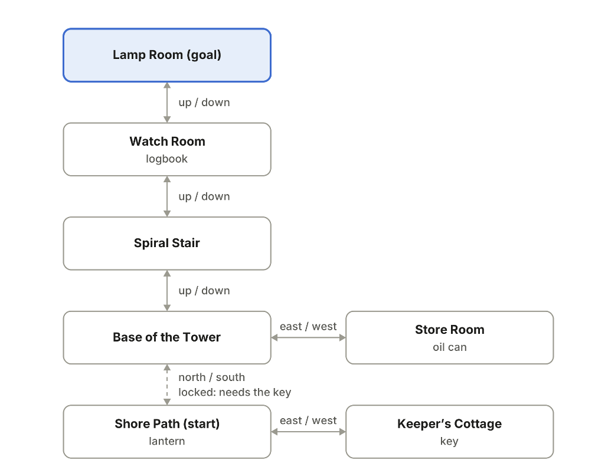
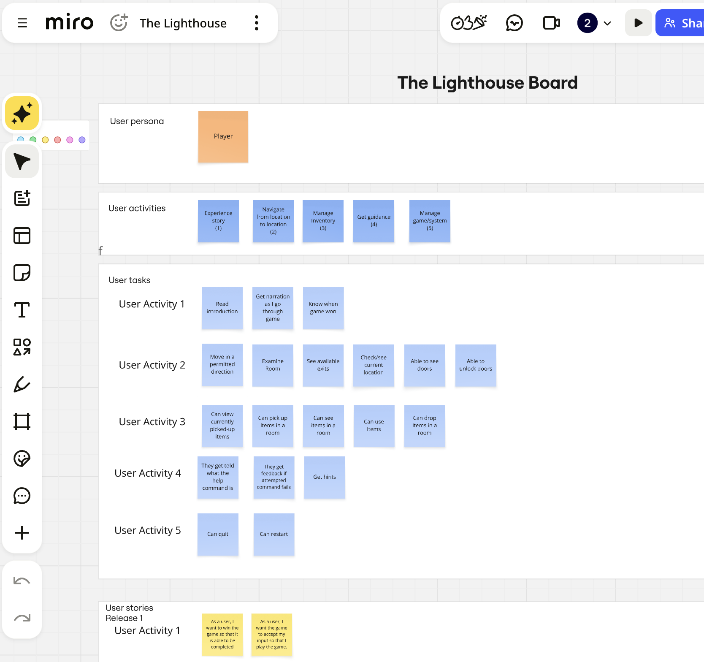
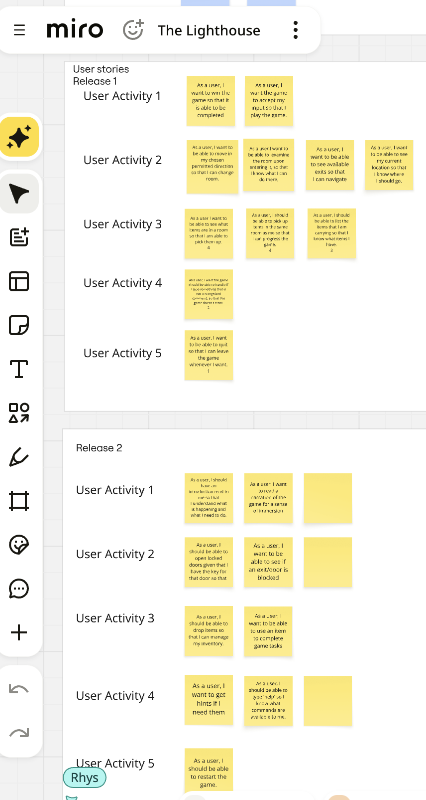

# The Lighthouse
A text adventure game

## Table of contents

> 1. [Overview](#overview)
> 2. [Development methodology](#approach)
> 3. [Testing](#testing)
> 4. [Credits](#credits) 
> 5. [Acknowledgements](#acknowledgements)

## Overview

[Back to top](#the-lighthouse)

This project was a team effort as part of an assignment that was designed to develop Java programming, git version control and Agile methodology skills.

The task description was an initial story scenario...

>A storm is rolling in off the Gower, the lighthouse lamp has gone dark, and a ship is heading for the rocks. The player wins by reaching the Lamp Room carrying the oil can, after finding the key that opens the tower door.

We had a map to work with

## Development methodology

[Back to top](#the-lighthouse)

An agile development methodology was followed for this project and these criteria were established

### User Personas

1. Player Persona

### User Activities and Tasks

#### User Activity 1 - Experience story

1. Read introduction
2. Get narration as I go through the game
3. Know when game won

#### User Activity 2 - Navigate between locations

1. Move in a permitted direction
2. Examine room
3. See available exits
4. Check/see current location
5. Able to see doors
6. Able to unlock doors

#### User Activity 3 - Manage inventory

1. Can view currently picked up items
2. Can pick up items in a room
3. Can see items in a room
4. Can use items
5. Can drop items in a room

#### User Activity 4 - Get guidance

1. They get told what the help command is
2. They get feedback if attempted command fails
3. Get hints

#### User Activity 5 - Manage game/system

1. Can quit
2. Can restart

We used a Miro board to organise these tasks

### User stories and release planning

Based on these tasks, we wrote user stories and organised them into numbered planned releases.

#### Release 1

##### User Activity 1

1. As a user, I want to win the game so that it is able to be completed.
2. As a user, I want the game to accept my input so that I play the game.

##### User Activity 2

1. As a user, I want to be able to move in my chosen direction so that I can change room.
2. As a user, I want to be able to examine the room upon entering it, so that I know what I can do there.
3. As a user, I want to be able to see available exits so that I can navigate.
4. As a user, I want to be able to see my current location so that I know where I should go.

##### User Activity 3

1. As a user I want to be able to see what items are in a room so that I am able to pick them up.
2. As a user, I should be able to pick up items in the same room as me so that I can progress the game.
3. As a user, I should be able to list the items that I am carrying so that I know what items I have.

##### User Activity 4

1. As a user, I want the game to be able to handle if I type something that is not a recognised command, so that the game doesn't error.

##### User Activity 5

1. As a user, I want to be able to quit so that I can leave the game whenever I want.

#### Release 2

##### User Activity 1

1. As a user, I should have and introduction read to me so that I understand what is happening and what I need to do.
2. As a user I want to read a narration of the game for a sense of immiersion.

##### User Activity 2

1. As a user, I should be able to open locked doors given that I have the key for that door.
2. As a user, I want to be able to see if an exit/door is blocked.

##### User Activity 3

1. As a user, I should be able to drop items so that I can manage my inventory.
2. As a user, I want to be able to use an item to complete game tasks.

##### User Activity 4

1. As a user, I want to get hints if I need them.
2. As a user, I should be able to type "help" so I know what commands are available to me.

###### User Activity 5

1. As a user, I should be able to restart the game.

These releases were planned on a Miro board as follows...

## Features

[Back to top](#the-lighthouse)

The player has to navigate a 3D map in the following directions: north, east, south, west, up and down.

The world map can define locked doors between exits. These doors can be unlocked with a "key" item that has to be found in the game.

The player has the following actions available to them...

- Move (move west)
- Unlock (unlock door, unlock north)
- Take (take item)
- Discard (discard item)
- Give (give item)
- Check inventory (inv / inventory / check inventory)
- Examine (examine)
- Look (look)
- Help (help)
- Map (map)
- Quit (quit)

## Technologies

[Back to top](#the-lighthouse)

- Java: development language
- JUnit: Java testing framework
- Miro: agile process planning
- GitHub Project: kanban board for task ticket handling
- Git: version control
- Visual Studio Code: IDE

## Testing

[Back to top](#the-lighthouse)

A fast and loose approach to TDD was followed for this project, resulting in pretty decent test coverage, approximately.

## Credits

Marco Grosso for the Lighthouse image in the readme. Taken from Unsplash.

## Acknowledgements

[Back to top](#the-lighthouse)

The Argonauts would like to acknowledge the training they've had from the Software Dev Masters staff in preparation for this Opus Magnus, the DVLA for sponsoring us. 

The Argonauts would also like to thank each other for being so damn good.

Argonauts out.

